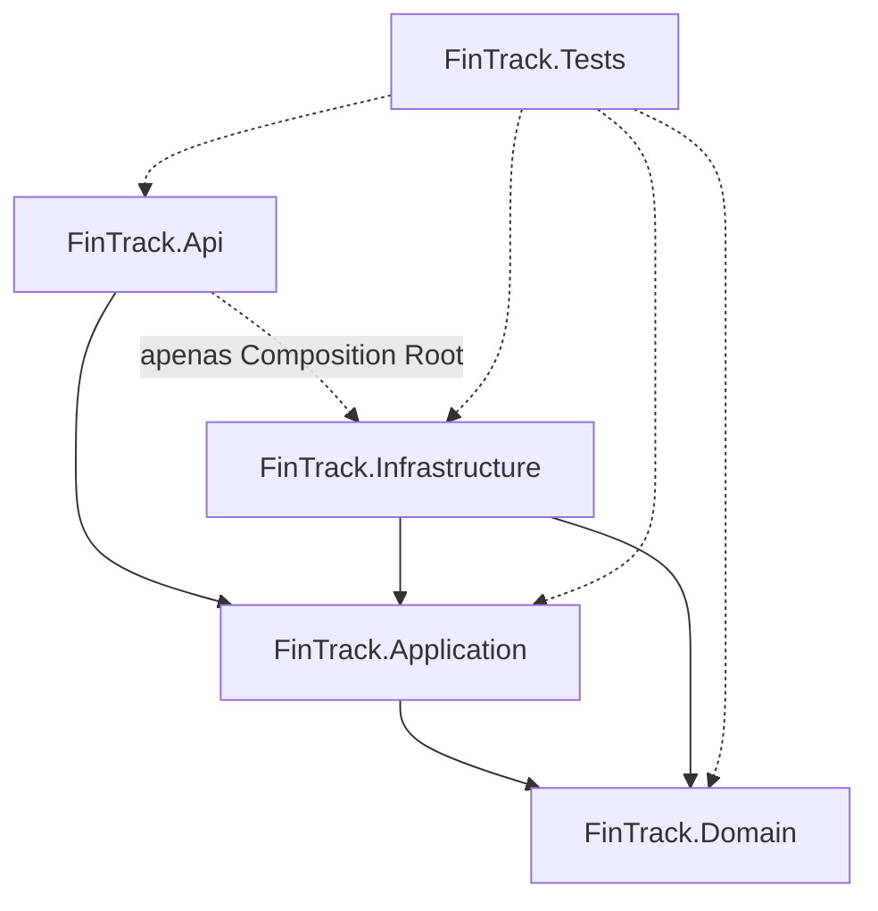
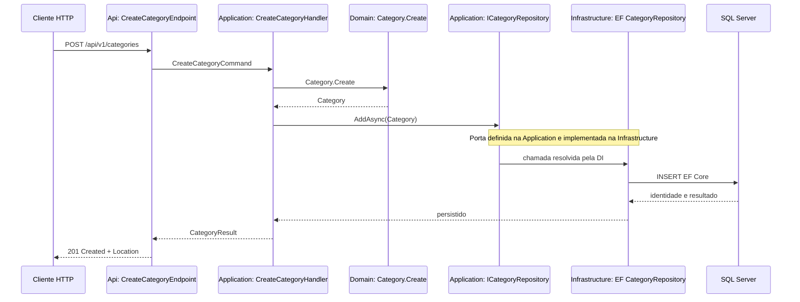

# Arquitetura de Referência — FinTrack v2.0

**Status:** proposta aprovada em princípio; execução somente sob autorização por passo.
**Estilo:** Clean Architecture simplificada, cases explícitos (sem MediatR), organização por feature na Application e na Api.

## 1. Projetos e responsabilidades

| Projeto | Responsabilidade | Pode referenciar |
|---|---|---|
| `FinTrack.Domain` | Entidades, invariantes, enumerações e comportamentos; sem frameworks | nenhum outro projeto |
| `FinTrack.Application` | Commands/queries, handlers, DTOs independentes de HTTP, ports e FluentValidation | `Domain` |
| `FinTrack.Infrastructure` | EF Core 10, SQL Server, mapeamentos, migrations, implementações de ports | `Application`, `Domain` |
| `FinTrack.Api` | Minimal APIs, contratos HTTP, status codes, OpenAPI, DI/Composition Root, Problem Details | `Application`; `Infrastructure` **somente para composição DI** |
| `FinTrack.Tests` | Testes Domain, handlers, arquitetura, integração SQL Server e HTTP/contrato | projetos testados |

### Diagrama de dependências de código

### Execução da feature CreateCategory

**A Infrastructure não chama o Handler em tempo de execução.** A dependência `Infrastructure -> Application` é uma relação de código de implementação de interface (inversão de dependência). APIs, desktops e consoles futuros podem reutilizar os mesmos casos de uso in-process. Um Desktop cliente-servidor, alternativamente, pode consumir a API sem referenciar Application.

## 2. Restrições automatizáveis (gates ARCH)

| ID | Regra técnica | Como verificar |
|---|---|---|
| ARCH-01 | Domain sem dependências para Api/Application/Infrastructure e sem bibliotecas web/EF | ProjectReference + testes de arquitetura |
| ARCH-02 | Application só pode referenciar Domain e não importar EF/ASP.NET/SQL | ProjectReference + testes estáticos e de assembly |
| ARCH-03 | Infrastructure pode referenciar Application/Domain, não Api | ProjectReference + testes de arquitetura |
| ARCH-04 | Api não pode referenciar Domain diretamente; Infrastructure usada somente na DI | ProjectReference + scanner + revisão de métodos e testes arquiteturais |
| ARCH-05 | Nenhum endpoint acessa DbContext, `IQueryable` ou repositório EF concreto | testes de arquitetura + inspeção/revisão |
| ARCH-06 | Ports da Application não expõem EF types, `DbContext`, `IQueryable`, `DbSet` nem SQL textual | testes de tipos de interface e análise do código |
| ARCH-07 | Use cases não conhecem `IResult`, `HttpContext`, endpoint routes, WPF nem SQL Server | análise de referências/assemblies |
| ARCH-08 | ArchitectureTests são descobertos e executados em todos os passos desde BOOT-002 | `dotnet test --filter FullyQualifiedName~ArchitectureTests` com conferência de descoberta |

Um teste que apenas confirma ausência de `ProjectReference` inválido é insuficiente para ARCH-04/05/06. O Playbook exige **testes efetivos sobre dependências entre tipos** (NetArchTest.Rules ou equivalente) e revisão explícita dos pontos de extensão/DI. A política é avaliada também em CI.

## 3. Regras de projeto

- Organization by feature: `Application/Features/Categories/CreateCategory/{Command,Handler,Validator,Result}.cs`; `Api/Features/Categories/CreateCategoryEndpoint.cs`. Domain organizado por conceitos (`Categories`, `Accounts`, `Transactions`) e Infrastructure por `Persistence`.
- Sem MediatR, event bus ou abstração de repositório genérica antecipada. DI nativa. Command/Handler com métodos `HandleAsync`.
- `DateOnly` para data civil, `decimal` para dinheiro, persistindo em `decimal(18,2)`; `TimeProvider` injetado nos use cases para validar datas sem acoplar Domain a relógio global.
- `Category.Nature` define receita ou despesa; `Account.Classifier` só para despesas; lançamento mantém valor **positivo** e não replica a natureza.
- Sem campo de saldo persistido: relatórios calculam `income - expenses` usando um repositório/porta de leitura definido pela Application. `IQueryable` não atravessa fronteira Application/Infrastructure.
- Domínio não deve receber DTO HTTP; strings externas `INCOME`/`EXPENSE` são traduzidas no adaptador de borda/uso de aplicação e mantidas coerentes com contrato, sem forçar o Domain a serializar valores externos.
- API não acessa EF Core nem repositórios diretamente. Pode chamar somente handlers/casos de uso Application; mapeamento de erros de negócio para HTTP vive na Api.
- Erros: Problem Details padronizados com status previstos no contrato, não inventar unicidade ou conflitos ausentes.
- Invariantes e regras de histórico devem ser testadas com dados de verdade antes de permitir exclusões/alterações.

## 4. Portabilidade

Trocar SQL Server por PostgreSQL requer alterações idealmente confinadas a Infrastructure/configuração de composição e testes de integração; os ports e use cases só permanecem intocados **se foram desenhados sem detalhes específicos do banco**. Trocar a interface HTTP por um cliente Windows in-process é possível reutilizando Application + Domain com composition root próprio; implementação Desktop é **fora do MVP**.
