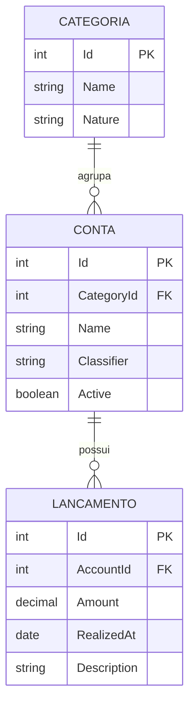

# FinTrack — Objetivos, Requisitos, Regras e Modelo Conceitual (v2)

## Declaração de objetivos

O FinTrack tem como objetivo auxiliar o usuário na organização, no acompanhamento e no controle de suas finanças pessoais, permitindo o registro de receitas e despesas efetivamente realizadas, organizadas em contas reutilizáveis e categorias financeiras, bem como a classificação das despesas segundo sua obrigatoriedade e variabilidade. O sistema disponibiliza histórico e informações consolidadas por conta, categoria, classificador e período, demonstrando totais e resultado financeiro.

## Entidades

| Entidade | Atributos essenciais | Responsabilidades | Relacionamento |
|---|---|---|---|
| Categoria | `Id`, `Name`, `Nature` | Agrupamento e natureza `INCOME`/`EXPENSE`; impedir alterações que corrompam significado do histórico | 1:N Conta |
| Conta | `Id`, `CategoryId`, `Name`, `Classifier?`, `Active` | Item financeiro reutilizável, classificar despesa `OF`,`OV`,`NOF`,`NOV`; ativar/desativar | N:1 Categoria; 1:N Lançamento |
| Lançamento | `Id`, `AccountId`, `Amount`, `RealizedAt`, `Description?` | Registrar fato realizado, com valor positivo e data; não repetir natureza/classificação | N:1 Conta |

`Classifier = null` para contas de RECEITA; uma mesma categoria pode conter contas com classificadores distintos. O termo Conta **não equivale necessariamente a conta bancária**.

## Requisitos funcionais

| ID | Requisito |
|---|---|
| RF01 | Gerenciar categorias (cadastrar, consultar, alterar, excluir quando permitido) |
| RF02 | Definir natureza das categorias (receita ou despesa) |
| RF03 | Gerenciar contas reutilizáveis associadas a categorias |
| RF04 | Classificar contas de despesa em OF/OV/NOF/NOV |
| RF05 | Associar múltiplos lançamentos à mesma conta |
| RF06 | Registrar receitas efetivamente recebidas |
| RF07 | Registrar despesas efetivamente pagas |
| RF08 | Corrigir ou excluir lançamentos incorretos |
| RF09 | Consultar histórico com filtros de período, conta, categoria e natureza |
| RF10 | Consolidar por conta |
| RF11 | Consolidar por categoria |
| RF12 | Consolidar totais e resultado por período |
| RF13 | Consolidar despesas por classificação OF/OV/NOF/NOV |
| RF14 | Desativar/ativar conta preservando histórico |

## Regras de negócio

| ID | Regra |
|---|---|
| RN01 | Categoria tem natureza `INCOME` ou `EXPENSE`. |
| RN02 | Conta pertence a uma única categoria obrigatória. |
| RN03 | Conta de despesa deve possuir um dos quatro classificadores válidos. |
| RN04 | Conta de receita não possui classificador de despesa. |
| RN05 | Cada lançamento pertence exatamente a uma conta. |
| RN06 | Valor de lançamento positivo, monetário com até 2 casas decimais. |
| RN07 | Lançamento representa operação efetivamente realizada; `realizedAt` não é futuro. |
| RN08 | Natureza do lançamento deriva da categoria vinculada à conta. |
| RN09 | Conta inativa não aceita novos lançamentos e mantém histórico consultável. |
| RN10 | Conta/categoria com dependência não são excluídas em cascata. |
| RN11 | Mudanças que reinterpretem dados históricos devem ser bloqueadas; política específica de renomeação API-P01 ainda precisa ser deliberada. |
| RN12 | Consolidações são calculadas: resultado = receita - despesa, sem saldo redundante persistido. |

## Restrições adicionais de escopo

- Valores ilustrativos em BRL, sem módulo de multicâmbio. Sem autenticação, múltiplos usuários, recorrências, orçamento/planejamento nem Desktop no MVP.
- Baseline canônico v2 do catálogo de 21 endpoints e DTOs: OpenAPI 3.1.0 em `docs/contracts/fintrack-openapi.yaml`, selecionado explicitamente em BOOT-000. O contrato anteriormente aprovado em 3.0.3 não estava disponível para comparação, portanto não se afirma equivalência semântica.
- Erros HTTP seguem RFC 9457 / Problem Details conforme OpenAPI.
- Tecnologias: .NET 10 + C# 14, ASP.NET Core 10, EF Core 10 + SQL Server, FluentValidation, xUnit, Docker, GitHub Actions.

## Requisitos não funcionais (referência RNF)

| ID | Requisito |
|---|---|
| RNF01 | Endpoints HTTP REST em ASP.NET Core. |
| RNF02 | Persistência SQL Server e EF Core. |
| RNF03 | Mapeamento por Entity Framework Core. |
| RNF04 | Validação de entradas com FluentValidation. |
| RNF05 | Documentação OpenAPI e interface Swagger/Scalar. |
| RNF06 | Testes xUnit com cobertura mensurável. |
| RNF07 | Ambiente containerizado via Docker Compose. |
| RNF08 | Código versionado em Git/GitHub. |
| RNF09 | Valores financeiros em decimal com precisão definida. |
| RNF10 | Respostas e erros HTTP consistentes. |
