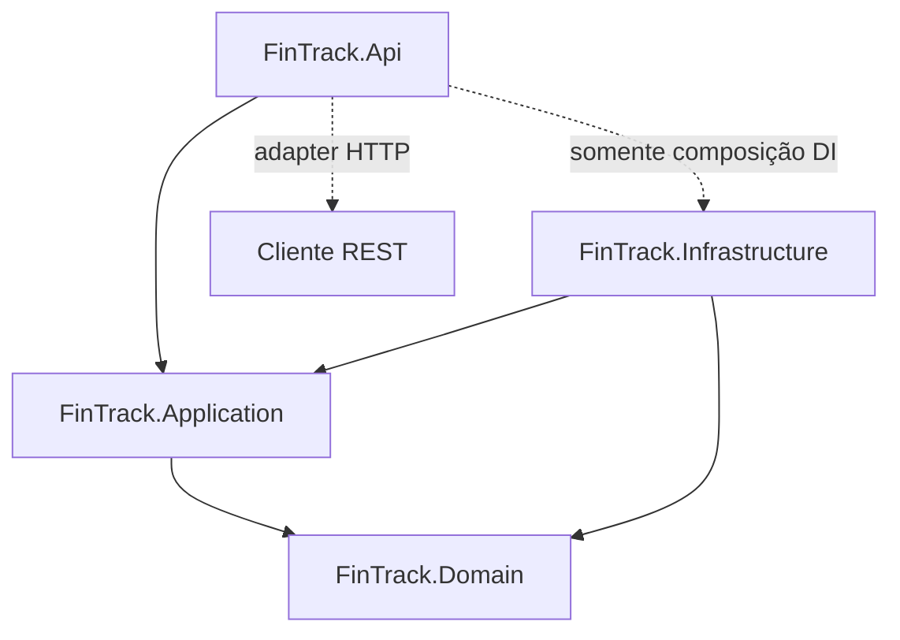

# FinTrack — Playbook Codex v2.0 (proposta para revisão)

**Status:** `PROPOSTA PARA REVISÃO` — premissas aprovadas em 19/10/2026; DEC-API-001 resolvida em BOOT-000; passos individuais continuam sujeitos a autorização exclusiva.

**Estratégia:** novo repositório (`fintrack-clean-v2` é apenas nome sugerido), preservando integralmente o repositório/histórico FinTrack v1.

**Produto:** registro de receitas/despesas realizadas, contas reutilizáveis por categoria, classificação OF/OV/NOF/NOV, histórico e consolidações; não inclui orçamento, autenticação ou aplicativo Windows no MVP.

**Stack:** .NET 10 LTS, C# 14, ASP.NET Core Minimal APIs, EF Core 10 + SQL Server, FluentValidation, xUnit, Docker Compose, OpenAPI 3.1, Git/GitHub, GitHub Actions, PowerShell.

**Execução:** Codex no VS Code, **exatamente um passo por autorização**, validação e commit após gates verdes, sem `push` automático.

> A autorização exclusiva de BOOT-000 permite apenas o congelamento documental descrito nesta etapa. As demais etapas exigem novas autorizações. Scripts anexos são instrumentos de governança e não comprovam testes na solution, ainda inexistente.

## 1. Autoridade e baseline

1. A **especificação de produto e regras** preserva RF01–RF14 e RN01–RN12 documentados em `docs/architecture/domain-and-requirements.md`.
2. `docs/contracts/fintrack-openapi.yaml` contém o baseline canônico aprovado para o v2 em OpenAPI 3.1.0 (21 operações, 25 schemas). Em BOOT-000, o usuário selecionou explicitamente o contrato atual como baseline; o contrato anteriormente aprovado em OpenAPI 3.0.3 não estava disponível para comparação. A decisão não afirma equivalência semântica com a versão ausente, e nenhuma alteração de contrato foi feita.
3. `docs/roadmap/steps.csv` é a fonte versionável dos passos e gates; `docs/traceability/endpoints.csv` vincula as 21 operações a passos e regras.
4. `docs/review/DECISIONS.md` registra questões deliberadamente em aberto. Particularmente **API-P01, renomeação de categoria com contas/histórico**, bloqueia CAT-007 até decisão aprovada.
5. `AGENTS.md` rege o agente Codex; alterações neste playbook/documentos requerem aprovação e commit rastreável. Artefatos v1 são históricos e não devem ser sobrescritos neste novo repositório.

## 2. Modelo arquitetural e direções de dependência



**Dependências em compilação:** `Api → Application`, `Application → Domain`, `Infrastructure → Application + Domain`, `Api → Infrastructure` **apenas para registro/configuração de DI**; `Domain → nenhum outro projeto`. `Tests` pode referenciar todos para testes. **Chamadas em runtime:** `Api → Application (Handler) → Interface (porta da Application) → Infrastructure (implementação via DI) → SQL Server`. O retorno percorre caminho inverso. A Infrastructure **não invoca o caso de uso**; ela implementa sua porta. `Application` nunca conhece `DbContext`, SQL, APIs HTTP ou WPF. Futuro `FinTrack.Desktop` pode invocar os mesmos handlers com composição de DI própria, sem obrigação de implementá-lo agora.

**Violação bloqueante:** `DbContext`/SQL em endpoints; repositório concreto na Application; referência Domain→Application ou Application→Infrastructure; `IQueryable`/`DbContext` em portas; regra de negócio na Api; acesso Api→Infrastructure fora do Composition Root. Comprovação obrigatória por `scripts/check-architecture.ps1` **e** `ArchitectureTests` reais (escritos em BOOT-002). Uma busca textual isolada não prova conformidade total.

## 3. Ciclo de execução: um passo / um commit

1. **Autorizar:** usuário envia explicitamente `Autorizo exclusivamente <ID>`. Conferir passo anterior, branch/working tree, contrato e decisões pendentes.
2. **Planejar o incremento:** o Codex declara arquivos mínimos, requisitos, interfaces, teste positivo/negativo, gates e impacto contratual, sem antecipar outra feature.
3. **Escrever testes e implementar:** começar pelo comportamento observável. Criar interface/handler na Application, invariantes no Domain, implementação concreta na Infrastructure, adaptador HTTP na Api — quando cada parte for necessária.
4. **Validar:** executar `scripts/validate-step.ps1 -StepId <ID>`; gates são derivados do CSV (sem permitir desativação manual para obter sinal verde). Em passos com banco, exigir SQL Server real e migrações. Validar architecture/contract por testes automatizados; registrar saída verdadeira.
5. **Inspecionar diffs/segredos:** `git diff --check`, `git status`, `git diff`, depois stage com caminhos explícitos (`git add <paths>`); `git diff --cached --check`; não adicionar logs com segredo nem arquivos gerados bin/obj.
6. **Evidenciar:** preencher `docs/progress/<ID>.md` copiando `docs/templates/step-report.md` com RF/RN, operações, testes (nomes e resultados), gates, decisões e arquivos modificados. Log local em `artifacts/validation/` (gitignored); só incluir resumo sem credenciais no commit.
7. **Commit:** somente gates verdes e nenhuma decisão pendente bloqueante; **um único commit** no passo: `<tipo>(<feature>): <ID> resumo`. Corpo: `RF: ...`, `RN: ...`, `OpenAPI: ...`, `Gates: ...`. Guardar SHA via `git rev-parse HEAD` **depois** do commit; não gravar SHA do próprio commit em arquivo commitado.
8. **Relatório e parada:** enviar ao revisor ID, mudanças, evidências, gates, SHA real e sugestão seguinte. Não executar próximo passo sem nova autorização; não fazer push, merge, release ou PR sem aprovação específica.

**Falha:** se gate falhar, corrigir **somente dentro do passo** e reexecutar. Falha de ferramenta não vira `PASS`; pré-requisito ausente bloqueia. Se exigir redefinir regra, contrato ou arquitetura, parar sem commit e solicitar decisão. Abster de `git reset --hard` ou descartar alterações do usuário.

## 4. Definition of Done e gates automáticos

| Gate | Regra | Quando obrigatório | Evidência |
|---|---|---|---|
| G0 | autorização explícita, pré-requisitos, decisões e clean working tree no início | todos | confirmação no relatório |
| G1 | `git diff --check` / inspeção segredos / diff staged | todos | diff/relatório |
| G2 | `dotnet restore`, `dotnet build -c Release`, `dotnet test -c Release` | desde BOOT-001 | log e resultados reais |
| G3 | regras de referência e testes `ArchitectureTests` descobertos | desde BOOT-002 | testes xUnit + checker |
| G4 | `docker compose config` e saúde SQL Server | nos passos marcados `requires_compose`/`requires_db` | saúde, integração |
| G5 | testes reais `IntegrationTests` em SQL Server, sem InMemory como prova de persistência | desde CAT-003, nos passos com SQL | xUnit + SQL isolado |
| G6 | `ContractTests` contra OpenAPI para operações HTTP (rota, status, DTO, erros) | desde CAT-004, nos passos HTTP | relatório de testes e comparação |
| G7 | Cobertura Cobertura/Coverlet mensurada e limiar decidido formalmente | REL-001 em diante | arquivo XML e thresholds aprovados |
| G8 | registro de evidências, commit atômico e SHA informado | todos | progress e `git log` |
| G9 | validação de integridade do contrato e rastreabilidade das 21 operações | BOOT-000 e a cada alteração dos contratos/roadmap | checker de metadados e teste de contrato |

**Importante:** `scripts/validate-step.ps1` executa preflight estrutural e comandos automáticos; os **critérios semânticos** da coluna *Aceite* continuam obrigatórios. `git push` não faz parte de nenhum gate automático. `Coverage >= 80%` não é regra aprovada; definir meta e métrica antes de torná-la bloqueante.

## 5. Sequência por feature

- **00 — Preparação:** 6 baby steps.
- **01 — Categorias:** 9 baby steps.
- **02 — Contas:** 9 baby steps.
- **03 — Lançamentos:** 9 baby steps.
- **04 — Relatórios:** 6 baby steps.
- **05 — Qualidade e entrega:** 5 baby steps.

> A sequência tem **44 passos**, cobre **21 operationIds** e reserva decisões humanas entre os passos. A feature Contas entrega seis endpoints; o histórico `GET /accounts/{id}/transactions` é finalizado em `TXN-008`, porque depende do domínio de lançamentos.

### Catálogo resumido

| Passo | Incremento | OperationId (se houver) | Gating adicional |
|---|---|---|---|
| BOOT-000 | Congelar baseline documental v2 | — | documental |
| BOOT-001 | Criar solution e SDK reprodutível | — | documental |
| BOOT-002 | Instalar gates arquiteturais | — | ARCH |
| BOOT-003 | Inicializar API e padrão de erros | — | ARCH |
| BOOT-004 | Infra SQL Server via Docker Compose | — | ARCH COMPOSE |
| BOOT-005 | Estabelecer CI e contrato de gates | — | ARCH |
| CAT-001 | Modelar Categoria no Domain | — | ARCH |
| CAT-002 | Application de categorias: criar e portas | — | ARCH |
| CAT-003 | Persistir categoria com EF Core | — | ARCH SQL COMPOSE |
| CAT-004 | Expor POST /categories | createCategory | ARCH SQL HTTP COMPOSE |
| CAT-005 | Expor GET /categories | listCategories | ARCH SQL HTTP COMPOSE |
| CAT-006 | Expor GET /categories/{id} | getCategory | ARCH SQL HTTP COMPOSE |
| CAT-007 | Expor PATCH /categories/{id} | updateCategory | ARCH SQL HTTP COMPOSE |
| CAT-008 | Expor DELETE /categories/{id} | deleteCategory | ARCH SQL HTTP COMPOSE |
| CAT-009 | Fechar feature Categorias | — | ARCH SQL HTTP COMPOSE |
| ACC-001 | Modelar Conta e classificador no Domain | — | ARCH |
| ACC-002 | Persistência e portas de Conta | — | ARCH SQL COMPOSE |
| ACC-003 | Expor POST /accounts | createAccount | ARCH SQL HTTP COMPOSE |
| ACC-004 | Expor GET /accounts | listAccounts | ARCH SQL HTTP COMPOSE |
| ACC-005 | Expor GET /accounts/{id} | getAccount | ARCH SQL HTTP COMPOSE |
| ACC-006 | Expor PATCH /accounts/{id} | updateAccount | ARCH SQL HTTP COMPOSE |
| ACC-007 | Expor PATCH /accounts/{id}/status | changeAccountStatus | ARCH SQL HTTP COMPOSE |
| ACC-008 | Expor DELETE /accounts/{id} | deleteAccount | ARCH SQL HTTP COMPOSE |
| ACC-009 | Fechar feature Contas | — | ARCH SQL HTTP COMPOSE |
| TXN-001 | Modelar Lançamento no Domain | — | ARCH |
| TXN-002 | Portas e persistência de lançamentos | — | ARCH SQL COMPOSE |
| TXN-003 | Expor POST /transactions | createTransaction | ARCH SQL HTTP COMPOSE |
| TXN-004 | Expor GET /transactions | listTransactions | ARCH SQL HTTP COMPOSE |
| TXN-005 | Expor GET /transactions/{id} | getTransaction | ARCH SQL HTTP COMPOSE |
| TXN-006 | Expor PATCH /transactions/{id} | updateTransaction | ARCH SQL HTTP COMPOSE |
| TXN-007 | Expor DELETE /transactions/{id} | deleteTransaction | ARCH SQL HTTP COMPOSE |
| TXN-008 | Expor GET /accounts/{id}/transactions | listAccountTransactions | ARCH SQL HTTP COMPOSE |
| TXN-009 | Fechar feature Lançamentos e regressões de Conta | — | ARCH SQL HTTP COMPOSE |
| REP-001 | Definir consultas de relatório na Application | — | ARCH |
| REP-002 | Expor GET /reports/summary | getFinancialSummary | ARCH SQL HTTP COMPOSE |
| REP-003 | Expor GET /reports/by-category | getReportByCategory | ARCH SQL HTTP COMPOSE |
| REP-004 | Expor GET /reports/by-account | getReportByAccount | ARCH SQL HTTP COMPOSE |
| REP-005 | Expor GET /reports/by-classifier | getReportByClassifier | ARCH SQL HTTP COMPOSE |
| REP-006 | Fechar feature Relatórios | — | ARCH SQL HTTP COMPOSE |
| REL-001 | Cobertura mensurável e critérios revisados | — | ARCH COB |
| REL-002 | Endurecimento de erros, dados e segurança | — | ARCH SQL HTTP COB COMPOSE |
| REL-003 | Finalizar pipeline CI de quality gates | — | ARCH SQL HTTP COB COMPOSE |
| REL-004 | README e tutorial de execução reproduzível | — | ARCH SQL HTTP COB COMPOSE |
| REL-005 | Aceite final MVP FinTrack v2 | — | ARCH SQL HTTP COB COMPOSE |

## 6. Fichas completas de execução

As fichas abaixo compõem as instruções a serem executadas; o Codex **não** deve substituir aceites específicos por mero sucesso de compilação. Em todos os passos, exigem-se `docs/progress/<ID>.md`, validação dos gates do manifesto e **commit único** depois de sucesso.

### BOOT-000 — Congelar baseline documental v2

- **Entrega mínima:** Novo repositório; importar pacote v2; comparar histórico v1 sem reescrever; checklist de lacunas e decisões; docs/progress/BOOT-000.md.
- **Aceite verificável:** Registrar versão do contrato, 5 projetos, 21 operationIds, pendências e autorização do passo. Não criar solution nem código.
- **Teste específico obrigatório:** Validar estrutura do pacote, matriz e integridade do YAML; git diff --check; revisão do diff e presença de evidência.
- **Rastreio:** ARQ-01..08; PB-01..12.
- **Commit esperado:** `docs(bootstrap): BOOT-000 congelar baseline documental v2` (resumo pode ser abreviado; manter ID).

### BOOT-001 — Criar solution e SDK reprodutível

- **Entrega mínima:** FinTrack.sln; projetos Api, Application, Domain, Infrastructure, Tests; global.json (.NET 10 instalado); Directory.Build.props; referências controladas.
- **Aceite verificável:** dotnet restore/build/test verdes; C# 14; projetos sem ciclos; dotnet --list-sdks registrado.
- **Teste específico obrigatório:** xUnit smoke real descoberto e executado; referências verificadas por script.
- **Rastreio:** ARQ-02; TEC-01..02.
- **Commit esperado:** `build(bootstrap): BOOT-001 criar solution e sdk reprodutível` (resumo pode ser abreviado; manter ID).

### BOOT-002 — Instalar gates arquiteturais

- **Entrega mínima:** Testes xUnit de arquitetura (NetArchTest.Rules ou equivalente fixado) e verificador de referências; teste negativo de violação controlado.
- **Aceite verificável:** Testes garantem regras de direção de dependência e acesso API→Infrastructure restrito à composição; violações simuladas são detectadas.
- **Teste específico obrigatório:** ArchitectureTests + scripts/check-architecture.ps1; rollback de simulação negativa.
- **Rastreio:** ARQ-01; ARQ-04..08.
- **Commit esperado:** `test(bootstrap): BOOT-002 instalar gates arquiteturais` (resumo pode ser abreviado; manter ID).

### BOOT-003 — Inicializar API e padrão de erros

- **Entrega mínima:** Minimal API, DI, OpenAPI, Problem Details, pipeline de exceções, configuração e healthcheck simples.
- **Aceite verificável:** Endpoint de health, app sobe sem DbContext injetado na rota; configuração DI unicamente em Program/composição.
- **Teste específico obrigatório:** Smoke HTTP e teste de middleware sem depender de persistência.
- **Rastreio:** RNF01; RNF05; RNF10.
- **Commit esperado:** `build(bootstrap): BOOT-003 inicializar api e padrão de erros` (resumo pode ser abreviado; manter ID).

### BOOT-004 — Infra SQL Server via Docker Compose

- **Entrega mínima:** compose.yaml com SQL Server, healthcheck, .env.example sem segredo, .gitignore e configuração por ambiente.
- **Aceite verificável:** docker compose config e up --wait verdes; conexão validada; nenhuma senha no Git.
- **Teste específico obrigatório:** Conectividade via cliente ou probe SQL; teste isolado de configuração.
- **Rastreio:** RNF02; RNF07.
- **Commit esperado:** `build(bootstrap): BOOT-004 infra sql server via docker compose` (resumo pode ser abreviado; manter ID).

### BOOT-005 — Estabelecer CI e contrato de gates

- **Entrega mínima:** Workflow GitHub Actions Windows/Linux conforme ferramentas; validação YAML e projeto; roteiros de falha e artefatos.
- **Aceite verificável:** Workflow executa gates que já existem e não mascara etapas indisponíveis; CI bloqueia merges inválidos.
- **Teste específico obrigatório:** Executar lint documental e validação local; conferir fluxos do CI sem apresentar execução remota inexistente.
- **Rastreio:** PB-03..10; TEC-14..15.
- **Commit esperado:** `ci(bootstrap): BOOT-005 estabelecer ci e contrato de gates` (resumo pode ser abreviado; manter ID).

### CAT-001 — Modelar Categoria no Domain

- **Entrega mínima:** Category e CategoryNature; criação por fábrica; nome e natureza válidos; sem HTTP/EF.
- **Aceite verificável:** Invariantes protegidas; nomes vazios e natureza inválida rejeitados; nenhum framework no Domain.
- **Teste específico obrigatório:** Testes de entidade com casos válidos/inválidos e igualdade de enums.
- **Rastreio:** RF01; RF02; RN01.
- **Commit esperado:** `feat(categories): CAT-001 modelar categoria no domain` (resumo pode ser abreviado; manter ID).

### CAT-002 — Application de categorias: criar e portas

- **Entrega mínima:** CreateCategoryCommand, Validator, Handler, Result e ICategoryRepository; regras de tradução INCOME/EXPENSE.
- **Aceite verificável:** Handler usa somente porta e domínio; teste de validação chama zero vezes o repositório; cancelamento propagado.
- **Teste específico obrigatório:** Unit tests com fake/mock + validação FluentValidation.
- **Rastreio:** RF01; RF02; RN01.
- **Commit esperado:** `feat(categories): CAT-002 application de categorias criar e portas` (resumo pode ser abreviado; manter ID).

### CAT-003 — Persistir categoria com EF Core

- **Entrega mínima:** DbContext, CategoryConfiguration, CategoryRepository, migration inicial, registro de DI.
- **Aceite verificável:** INSERT e leitura real SQL Server; repositório implementa interface na Application; migration idempotente testada.
- **Teste específico obrigatório:** IntegrationTests com banco isolado; migrate + roundtrip categoria.
- **Rastreio:** RF01; RN01.
- **Commit esperado:** `feat(categories): CAT-003 persistir categoria com ef core` (resumo pode ser abreviado; manter ID).

### CAT-004 — Expor POST /categories

- **Entrega mínima:** Minimal endpoint mapeado ao CreateCategoryHandler, payload público e response Location.
- **Aceite verificável:** 201 e Location, JSON válido, 400/422 documentados; API não toca DbContext; contrato createCategory aderente.
- **Teste específico obrigatório:** ContractTests + IntegrationTests + negativos nome/natureza.
- **Rastreio:** RF01; RF02; RN01 · OpenAPI `createCategory`.
- **Commit esperado:** `feat(categories): CAT-004 expor post categories` (resumo pode ser abreviado; manter ID).

### CAT-005 — Expor GET /categories

- **Entrega mínima:** ListCategoriesQuery/Handler e endpoint; filtro opcional nature.
- **Aceite verificável:** 200 com lista vazia/cheia; filtro validado; sem consulta EF fora da Infrastructure.
- **Teste específico obrigatório:** ContractTests + integração e lista filtrada.
- **Rastreio:** RF01; RF02 · OpenAPI `listCategories`.
- **Commit esperado:** `feat(categories): CAT-005 expor get categories` (resumo pode ser abreviado; manter ID).

### CAT-006 — Expor GET /categories/{id}

- **Entrega mínima:** GetCategoryQuery/Handler e busca por ID.
- **Aceite verificável:** 200 para existente; 404 para ausente; 400 para identificador inválido, conforme contrato.
- **Teste específico obrigatório:** HTTP e testes com ids inexistentes e fronteiras.
- **Rastreio:** RF01 · OpenAPI `getCategory`.
- **Commit esperado:** `feat(categories): CAT-006 expor get categoriesid` (resumo pode ser abreviado; manter ID).

### CAT-007 — Expor PATCH /categories/{id}

- **Entrega mínima:** UpdateCategoryCommand/Handler e endpoint; política de mudança/renomeação deliberada.
- **Aceite verificável:** BLOQUEADO enquanto API-P01 estiver pendente; após decisão formal, proteger histórico/relacionamentos e 409 cabível.
- **Teste específico obrigatório:** Testes de renomeação, alteração de natureza, casos com contas/histórico e negativa 409.
- **Rastreio:** RF01; RN11; API-P01 · OpenAPI `updateCategory`.
- **Commit esperado:** `feat(categories): CAT-007 expor patch categoriesid` (resumo pode ser abreviado; manter ID).

### CAT-008 — Expor DELETE /categories/{id}

- **Entrega mínima:** DeleteCategoryHandler e endpoint com integridade FK.
- **Aceite verificável:** 204 se sem contas; 404 inexistente; 409 com contas; nenhuma exclusão em cascata.
- **Teste específico obrigatório:** Integração FK e 409 com vínculo.
- **Rastreio:** RF01; RN10 · OpenAPI `deleteCategory`.
- **Commit esperado:** `feat(categories): CAT-008 expor delete categoriesid` (resumo pode ser abreviado; manter ID).

### CAT-009 — Fechar feature Categorias

- **Entrega mínima:** Relatório de fechamento, smoke dos 5 endpoints, checklist e autorização humana.
- **Aceite verificável:** 5 operações cobertas; CRUD e regras verdes; nenhuma mudança silenciosa de contrato.
- **Teste específico obrigatório:** Suite completa de categorias, arquitetura, integração e conformidade.
- **Rastreio:** RF01; RF02; RN01; RN10; RN11.
- **Commit esperado:** `test(categories): CAT-009 fechar feature categorias` (resumo pode ser abreviado; manter ID).

### ACC-001 — Modelar Conta e classificador no Domain

- **Entrega mínima:** Account, ExpenseClassifier (OF/OV/NOF/NOV), status, CategoryId e invariantes de transição.
- **Aceite verificável:** Despesa exige classificador; receita não admite; integração com natureza avaliada via caso de uso sem acoplar CategoryRepo ao Domain.
- **Teste específico obrigatório:** Testes para quatro classes, receita e conta desativada.
- **Rastreio:** RF03; RF04; RF05; RN02; RN03; RN04.
- **Commit esperado:** `feat(accounts): ACC-001 modelar conta e classificador no domain` (resumo pode ser abreviado; manter ID).

### ACC-002 — Persistência e portas de Conta

- **Entrega mínima:** IAccountRepository na Application; EF configuration, FK Categoria, migration e DI.
- **Aceite verificável:** Categoria existente obrigatória, FK ativa; sem cascade-delete; migration sobe no SQL Server real.
- **Teste específico obrigatório:** Integração cria conta válida, rejeita FK ausente, preserva categoria.
- **Rastreio:** RF03; RN02; RN10.
- **Commit esperado:** `feat(accounts): ACC-002 persistência e portas de conta` (resumo pode ser abreviado; manter ID).

### ACC-003 — Expor POST /accounts

- **Entrega mínima:** CreateAccountHandler/Validator e endpoint com consulta à categoria via interface.
- **Aceite verificável:** 201, Location, 422 para classificador incoerente, FK existente; nenhum DbContext em endpoint.
- **Teste específico obrigatório:** Testes de natureza e classificação + contrato CreateAccount.
- **Rastreio:** RF03; RF04; RN02; RN03; RN04 · OpenAPI `createAccount`.
- **Commit esperado:** `feat(accounts): ACC-003 expor post accounts` (resumo pode ser abreviado; manter ID).

### ACC-004 — Expor GET /accounts

- **Entrega mínima:** ListAccountsQuery e filtros categoryId, active, classifier.
- **Aceite verificável:** 200 e filtros conforme contrato; dados ordenados de modo determinístico se necessário e documentado.
- **Teste específico obrigatório:** Integração diferentes categorias e status; Schema AccountList.
- **Rastreio:** RF03 · OpenAPI `listAccounts`.
- **Commit esperado:** `feat(accounts): ACC-004 expor get accounts` (resumo pode ser abreviado; manter ID).

### ACC-005 — Expor GET /accounts/{id}

- **Entrega mínima:** GetAccountQuery e endpoint.
- **Aceite verificável:** 200/404 e campos id, categoria, classificador e active corretos.
- **Teste específico obrigatório:** Testes positivos/negativos HTTP + EF.
- **Rastreio:** RF03 · OpenAPI `getAccount`.
- **Commit esperado:** `feat(accounts): ACC-005 expor get accountsid` (resumo pode ser abreviado; manter ID).

### ACC-006 — Expor PATCH /accounts/{id}

- **Entrega mínima:** UpdateAccountHandler; proteger histórico contra reclassificações.
- **Aceite verificável:** 409 em alterações que reinterpretam lançamentos existentes; classificador e categoria coerentes; nome editável.
- **Teste específico obrigatório:** Testes com e sem lançamentos; alterações vedadas; contrato.
- **Rastreio:** RF03; RF04; RN11 · OpenAPI `updateAccount`.
- **Commit esperado:** `feat(accounts): ACC-006 expor patch accountsid` (resumo pode ser abreviado; manter ID).

### ACC-007 — Expor PATCH /accounts/{id}/status

- **Entrega mínima:** Activate/DeactivateAccountHandler e endpoint específico.
- **Aceite verificável:** Permite troca status; desativada não aceita novas transações (comprovado depois TXN-003).
- **Teste específico obrigatório:** Teste HTTP status, 404, repetição idempotente; regressão no TXN-003.
- **Rastreio:** RF14; RN09 · OpenAPI `changeAccountStatus`.
- **Commit esperado:** `feat(accounts): ACC-007 expor patch accountsidstatus` (resumo pode ser abreviado; manter ID).

### ACC-008 — Expor DELETE /accounts/{id}

- **Entrega mínima:** DeleteAccountHandler e endpoint.
- **Aceite verificável:** 204 sem lançamentos; 409 com lançamentos quando existir feature TXN (gate posterior); 404 inexistente.
- **Teste específico obrigatório:** Testar inicialmente sem lançamento; ampliar testes na feature Transações.
- **Rastreio:** RF03; RN10 · OpenAPI `deleteAccount`.
- **Commit esperado:** `feat(accounts): ACC-008 expor delete accountsid` (resumo pode ser abreviado; manter ID).

### ACC-009 — Fechar feature Contas

- **Entrega mínima:** Relatório dos 6 endpoints próprios; checklist de consistência e impacto de transações futuras.
- **Aceite verificável:** Operações 6/7 de Contas cobertas; histórico de conta reservado à feature Transações.
- **Teste específico obrigatório:** Suite Contas + arquitetura + SQL; marcar casos dependentes de TXN pendentes, não falsamente verdes.
- **Rastreio:** RF03; RF04; RF05; RF14; RN02..04; RN09..11.
- **Commit esperado:** `test(accounts): ACC-009 fechar feature contas` (resumo pode ser abreviado; manter ID).

### TXN-001 — Modelar Lançamento no Domain

- **Entrega mínima:** Transaction, Amount decimal(18,2), RealizedAt DateOnly, Description; invariantes sem relógio estático.
- **Aceite verificável:** Valor > 0 com duas casas; data civil; nenhuma natureza redundante; data futura validada no caso de uso por TimeProvider.
- **Teste específico obrigatório:** Testes de valor 0, negativo, 3 decimais, descrição e data.
- **Rastreio:** RF06; RF07; RN05; RN06; RN08.
- **Commit esperado:** `feat(transactions): TXN-001 modelar lançamento no domain` (resumo pode ser abreviado; manter ID).

### TXN-002 — Portas e persistência de lançamentos

- **Entrega mínima:** ITransactionRepository, mapper EF Core, migration, índice por conta/data; DI.
- **Aceite verificável:** FK de Conta; tipos SQL corretos; roundtrip monetário; sem cascade histórico.
- **Teste específico obrigatório:** Integração FK, precisão e migration SQL Server.
- **Rastreio:** RF05; RF06; RF07; RN05; RN06; RN10.
- **Commit esperado:** `feat(transactions): TXN-002 portas e persistência de lançamentos` (resumo pode ser abreviado; manter ID).

### TXN-003 — Expor POST /transactions

- **Entrega mínima:** CreateTransactionHandler, TimeProvider injetado, valida existência/ativa e data de realização.
- **Aceite verificável:** 201 + Location; 409 para conta inativa; rejeita futuro/valor inválido; determina natureza pela conta/categoria.
- **Teste específico obrigatório:** Contrato POST, smoke, testes de conta inativa e datas-limite.
- **Rastreio:** RF06; RF07; RN05..09 · OpenAPI `createTransaction`.
- **Commit esperado:** `feat(transactions): TXN-003 expor post transactions` (resumo pode ser abreviado; manter ID).

### TXN-004 — Expor GET /transactions

- **Entrega mínima:** ListTransactionsQuery, filtros e paginação conforme OpenAPI.
- **Aceite verificável:** 200 com paginação metadata, ordenação determinística, from/to inclusivos e filters coerentes.
- **Teste específico obrigatório:** Fronteiras de paginação, período invertido e resultados vazios.
- **Rastreio:** RF09; RN08 · OpenAPI `listTransactions`.
- **Commit esperado:** `feat(transactions): TXN-004 expor get transactions` (resumo pode ser abreviado; manter ID).

### TXN-005 — Expor GET /transactions/{id}

- **Entrega mínima:** GetTransactionQuery e endpoint.
- **Aceite verificável:** 200/404, representa valor/data ISO e descrição nula conforme schema.
- **Teste específico obrigatório:** HTTP Schema Transaction e testes de busca.
- **Rastreio:** RF09 · OpenAPI `getTransaction`.
- **Commit esperado:** `feat(transactions): TXN-005 expor get transactionsid` (resumo pode ser abreviado; manter ID).

### TXN-006 — Expor PATCH /transactions/{id}

- **Entrega mínima:** UpdateTransactionHandler, relógio injetado e valida nova conta se houver.
- **Aceite verificável:** Não admite data futura; nova conta deve existir/ativa; parcial válido mantém outros campos.
- **Teste específico obrigatório:** HTTP + integração: alterou valor/conta/data, regra com inativa, invalid date.
- **Rastreio:** RF08; RN06; RN07; RN09 · OpenAPI `updateTransaction`.
- **Commit esperado:** `feat(transactions): TXN-006 expor patch transactionsid` (resumo pode ser abreviado; manter ID).

### TXN-007 — Expor DELETE /transactions/{id}

- **Entrega mínima:** DeleteTransactionHandler e endpoint; sem soft delete implícito.
- **Aceite verificável:** 204 se existente; 404 ausente; totais futuros deixam de considerar lançamento apagado.
- **Teste específico obrigatório:** HTTP e integração do estado pós-delete.
- **Rastreio:** RF08; RN12 · OpenAPI `deleteTransaction`.
- **Commit esperado:** `feat(transactions): TXN-007 expor delete transactionsid` (resumo pode ser abreviado; manter ID).

### TXN-008 — Expor GET /accounts/{id}/transactions

- **Entrega mínima:** ListAccountTransactionsQuery na Application; endpoint de histórico vinculado.
- **Aceite verificável:** 200, 404 conta ausente, filtros e paginação do contrato; mesma fonte de dados do listTransactions.
- **Teste específico obrigatório:** Integração com conta ativa/inativa, múltiplos lançamentos e períodos.
- **Rastreio:** RF09; RN09 · OpenAPI `listAccountTransactions`.
- **Commit esperado:** `feat(transactions): TXN-008 expor get accountsidtransactions` (resumo pode ser abreviado; manter ID).

### TXN-009 — Fechar feature Lançamentos e regressões de Conta

- **Entrega mínima:** Suite de 6 operações, retomada de regras de Conta com lançamentos, relatório de feature.
- **Aceite verificável:** Exclusão de Conta com históricos 409; mudança indevida 409; desativada não aceita POST; sem alteração de contratos.
- **Teste específico obrigatório:** Regressão Accounts+Transactions + Arch + SQL + Contract.
- **Rastreio:** RF05..09; RF14; RN05..12.
- **Commit esperado:** `test(transactions): TXN-009 fechar feature lançamentos e regressões de conta` (resumo pode ser abreviado; manter ID).

### REP-001 — Definir consultas de relatório na Application

- **Entrega mínima:** Query/Result DTOs e IReadReportRepository sem IQueryable/DbContext; consultas read-only.
- **Aceite verificável:** Contractos retornam agregados decimais; período inclusivo validado; nenhuma persistência de saldo consolidado.
- **Teste específico obrigatório:** Testes de consulta com fake, valida intervalo.
- **Rastreio:** RF10..13; RN12.
- **Commit esperado:** `feat(reports): REP-001 definir consultas de relatório na application` (resumo pode ser abreviado; manter ID).

### REP-002 — Expor GET /reports/summary

- **Entrega mínima:** GetFinancialSummaryHandler, SQL agregação receita/despesa por intervalo.
- **Aceite verificável:** income-expenses=balance, inclusive, sem dados=0, SQL compatível com precisão.
- **Teste específico obrigatório:** IntegrationTests com cenário reproduzível e ContractTests.
- **Rastreio:** RF12; RN08; RN12 · OpenAPI `getFinancialSummary`.
- **Commit esperado:** `feat(reports): REP-002 expor get reportssummary` (resumo pode ser abreviado; manter ID).

### REP-003 — Expor GET /reports/by-category

- **Entrega mínima:** GetReportByCategoryHandler, agrupamento por categoria e natureza.
- **Aceite verificável:** Totais por categoria corretos, não duplica valores e respeita período.
- **Teste específico obrigatório:** Integração duas categorias+contas, despesas/receitas e schema.
- **Rastreio:** RF11; RN12 · OpenAPI `getReportByCategory`.
- **Commit esperado:** `feat(reports): REP-003 expor get reportsby-category` (resumo pode ser abreviado; manter ID).

### REP-004 — Expor GET /reports/by-account

- **Entrega mínima:** GetReportByAccountHandler, agrupamento por conta reutilizável.
- **Aceite verificável:** Agrupa históricos da mesma conta; respeita categoria e natureza e datas inclusivas.
- **Teste específico obrigatório:** Integração com múltiplos lançamentos de mesma conta.
- **Rastreio:** RF10; RN12 · OpenAPI `getReportByAccount`.
- **Commit esperado:** `feat(reports): REP-004 expor get reportsby-account` (resumo pode ser abreviado; manter ID).

### REP-005 — Expor GET /reports/by-classifier

- **Entrega mínima:** GetReportByClassifierHandler, agregação OF/OV/NOF/NOV.
- **Aceite verificável:** Somente despesas participam; receitas excluídas; quatro categorias corretas.
- **Teste específico obrigatório:** Integração 4 grupos e contraprova conta INCOME.
- **Rastreio:** RF13; RN03; RN04; RN12 · OpenAPI `getReportByClassifier`.
- **Commit esperado:** `feat(reports): REP-005 expor get reportsby-classifier` (resumo pode ser abreviado; manter ID).

### REP-006 — Fechar feature Relatórios

- **Entrega mínima:** Suite de consolidações, invariantes de balanço e checklist dos quatro endpoints.
- **Aceite verificável:** 4 relatórios coerentes com fonte transacional; não salvar agregados; validações verdes.
- **Teste específico obrigatório:** Integração + contrato + arquitetura; matriz de resultados auditável.
- **Rastreio:** RF10..13; RN12.
- **Commit esperado:** `test(reports): REP-006 fechar feature relatórios` (resumo pode ser abreviado; manter ID).

### REL-001 — Cobertura mensurável e critérios revisados

- **Entrega mínima:** Coverlet collector, artefatos Cobertura, regras de qualidade com limite aprovado.
- **Aceite verificável:** Relatório reproduzível; nenhuma porcentagem suposta; meta numérica somente depois de aprovação explícita no passo.
- **Teste específico obrigatório:** dotnet test --collect:"XPlat Code Coverage" e checagem de saída do coletor.
- **Rastreio:** PB-03; TEC-09.
- **Commit esperado:** `test(release): REL-001 cobertura mensurável e critérios revisados` (resumo pode ser abreviado; manter ID).

### REL-002 — Endurecimento de erros, dados e segurança

- **Entrega mínima:** Problem Details consistente, segredo fora do repositório, tratamento e serialização edge-cases.
- **Aceite verificável:** Não vazar exception trace/SQL; 400/404/409/422 do contrato; logging mínimo sem dados financeiros sensíveis.
- **Teste específico obrigatório:** Testes negativos end-to-end e inspeção de segredos no diff.
- **Rastreio:** RNF10; TEC-07.
- **Commit esperado:** `test(release): REL-002 endurecimento de erros dados e segurança` (resumo pode ser abreviado; manter ID).

### REL-003 — Finalizar pipeline CI de quality gates

- **Entrega mínima:** Workflow pronto para restore/build/test/architecture/contract/integration/cobertura; publicação de resultados.
- **Aceite verificável:** CI só verde quando gates obrigatórios verdes; banco efêmero e segredos de CI seguros.
- **Teste específico obrigatório:** Executar workflow no GitHub após autorização de push, reportar link real; não inventar execução remota.
- **Rastreio:** PB-03..10; TEC-14.
- **Commit esperado:** `ci(release): REL-003 finalizar pipeline ci de quality gates` (resumo pode ser abreviado; manter ID).

### REL-004 — README e tutorial de execução reproduzível

- **Entrega mínima:** README final, comandos para Docker e .NET, configuração sem segredo e roteiro 21 endpoints.
- **Aceite verificável:** Novo desenvolvedor reproduz o sistema; exemplos conferidos com contrato; limitações documentadas.
- **Teste específico obrigatório:** Smoke local do roteiro; conferência da documentação com OpenAPI.
- **Rastreio:** PB-06; TEC-11..13.
- **Commit esperado:** `docs(release): REL-004 readme e tutorial de execução reproduzível` (resumo pode ser abreviado; manter ID).

### REL-005 — Aceite final MVP FinTrack v2

- **Entrega mínima:** Relatório final: matriz 21/21, rastreabilidade por SHA e aprovação final da entrega.
- **Aceite verificável:** Todos os passos concluídos e aprovados; gates completos verdes; sem pendências bloqueantes nem claims não verificados.
- **Teste específico obrigatório:** End-to-end smoke, testes, contrato, arquitetura e integração; revisão Git commits e log.
- **Rastreio:** RF01..14; RN01..12; PB-01..12.
- **Commit esperado:** `test(release): REL-005 aceite final mvp fintrack v2` (resumo pode ser abreviado; manter ID).

## 7. Protocolo de conclusão por feature

- Conferir que todas as fichas da feature foram executadas/autorizadas e o log registra um commit por passo, sem SHA inventado.
- Rodar suite completa de domain/application/architecture + contrato, SQL Server e smoke HTTP, se aplicáveis.
- Conferir `docs/traceability/endpoints.csv` e que não há `operationId` sem teste; fechar pendências ou emitir bloqueio, jamais mascarar como realizado.
- Registrar `docs/progress/<FEATURE>-ACCEPTANCE.md` conforme template; solicitar aceite humano antes da feature seguinte.
- Contar passos e endpoints cobertos. Qualquer adição fora das 21 operações exige controle de mudança aprovado.

## 8. Utilização no VS Code

1. Crie **novo repositório** vazio, sem clonar/copiar código do v1 para evitar misturar históricos.
2. Copie os arquivos deste pacote para a raiz, sem mudar caminhos. `AGENTS.md` deve estar na raiz e ser lido pelo Codex.
3. Verifique `dotnet --list-sdks`, `git --version` e `docker --version`; PowerShell `pwsh` ou Windows PowerShell disponível.
4. Inicialize `git init` **manualmente**, configure identidade Git e confira `git status`. A ação não significa que um passo está autorizado.
5. Envie ao Codex **somente** `Autorizo exclusivamente BOOT-000`; não o autorize a executar vários passos de uma vez. A decisão DEC-API-001 foi resolvida escolhendo o baseline 3.1.0 atual, sem alegar comparação com o contrato 3.0.3 indisponível.
6. Para passos futuros, use `powershell -NoProfile -ExecutionPolicy Bypass -File scripts/validate-step.ps1 -StepId CAT-004` no PowerShell tradicional ou `pwsh -File scripts/validate-step.ps1 -StepId CAT-004` no PowerShell 7. O script falhará intencionalmente antes de a solution e os testes necessários existirem.

### Prompt-base para cada autorização

```text
Leia AGENTS.md, docs/playbooks/FINTRACK_PLAYBOOK_V2.md,
docs/roadmap/steps.csv, docs/architecture/*,
docs/review/DECISIONS.md e docs/contracts/fintrack-openapi.yaml.

AUTORIZO EXCLUSIVAMENTE: <ID>
1. Confirme as dependências e os requisitos deste passo.
2. Mostre o plano mínimo, sem antecipar outros passos.
3. Execute apenas o incremento e seus testes.
4. Rode scripts/validate-step.ps1 -StepId <ID> e os gates semânticos.
5. Se falhar ou depender de decisão pendente, pare SEM commit.
6. Se passar, preencha docs/progress/<ID>.md; revise e faça um único commit.
7. Mostre SHA real, testes executados, evidências e próximo passo proposto.
Não faça push, merge, PR nem continue por conta própria.
```

## 9. Fora de escopo e mudança controlada

- Não implementar FinTrack.Desktop, autenticação, orçamento, múltiplas moedas, recorrências, cartões, integrações bancárias ou CQRS/MediatR no MVP.
- Não alterar semanticamente nomes de DTOs e status HTTP para 'facilitar' implementação; primeiro alterar contrato com aprovação.
- Não editar histórico v1; se precisar referenciá-lo, registrar origem da decisão no ADR e no rastreio sem copiar commits.
- Nenhum hardcode de segredos em compose, logs, README ou testes.

## 10. Condição de entrega da revisão

**Este pacote é somente documental e de governança.** Os scripts foram preparados e podem ser inspecionados; **não foram executados contra uma solution FinTrack v2**, pois ela ainda não existe. A implementação e os commits aguardam comando posterior e específico de autorização.
